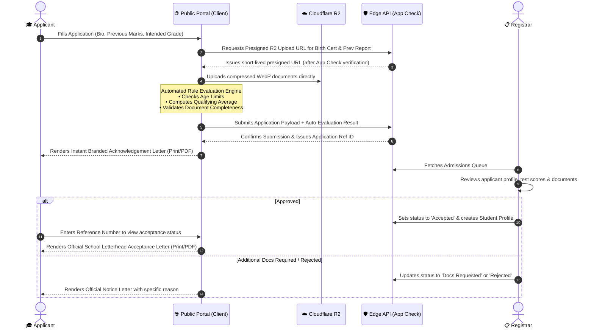

# 🏫 Multi-Tenant School Management System (SaaS)
## Strategic Architecture: Tiered Cloudflare + Firebase + Zero-Trust App Check

---

### 1. Strategic Multi-Database & Multi-Storage Decision Engine

To achieve the **absolute lowest cost** and **highest scalability**, we do not choose just one database or storage service. Instead, we strategically route every data type to the service where it is cheapest and most effective:

```mermaid
flowchart TD
    subgraph ClientLayer["💻 Client Application (React 19 + TypeScript)"]
        UI["Unified School Portal"]
        AC["Firebase App Check (reCAPTCHA Enterprise)"]
        AUTH["Firebase Auth (Custom Claims)"]
    end

    subgraph StorageLayer["📦 Tiered Object Storage Strategy"]
        FS_STOR["🔥 Firebase Storage<br/>• User Profile Avatars<br/>• School Crests & Logos<br/>• Authorized Signatures & Stamps<br/>(Low frequency, small size, fast client-rule auth)"]
        CF_R2["☁️ Cloudflare R2<br/>• Scanned Applicant Docs (Birth Certs, IDs)<br/>• Homework Attachments & Student Submissions<br/>• High-Res Teacher Slides & Notes<br/>($0 Egress Bandwidth Fees FOREVER!)"]
    end

    subgraph DatabaseLayer["🗄️ Tiered Multi-Database Strategy"]
        RTDB["🔥 Firebase Realtime Database (RTDB)<br/>• Live Presence (Online Status)<br/>• Realtime Notification Badges<br/>• Admissions Queue Status Counter<br/>(WebSocket stream, NO per-read/write fee!)"]
        CF_D1["☁️ Cloudflare D1 (Edge SQL)<br/>• Heavy Gradebooks & Assessment Marks<br/>• Historical Academic Records<br/>• Relational Classes, Terms & Rosters<br/>(5,000,000 Free Reads/Day!)"]
        FIRESTORE["🔥 Cloud Firestore (IndexedDB Cached)<br/>• School Tenant Config & Letterhead Templates<br/>• Admission Rules & Cut-off Criteria<br/>(Aggressive offline caching = near-0 billable reads)"]
    end

    UI -->|Attestation Token| AC
    UI -->|JWT + Role Claims| AUTH
    UI -->|Direct SDK (Small/Cached)| FS_STOR
    UI -->|Presigned URLs (Heavy/Large)| CF_R2
    UI -->|WebSocket Subscriptions| RTDB
    UI -->|API Gateway (App Check Validated)| CF_D1
    UI -->|Cached Documents| FIRESTORE
```

#### Detailed Service Routing Criteria

| Feature / Data Asset | Assigned Service | Specific Architectural & Cost Rationale |
| :--- | :--- | :--- |
| **Profile Photos & Avatars** | **Firebase Storage** | Small files ($<100$KB), low download frequency, direct client-side SDK integration with Firebase Auth security rules. |
| **School Crests, Logos & Stamps** | **Firebase Storage** | Static assets cached heavily by CDN; quick setup with no presigned URL overhead. |
| **Applicant Birth Certs, IDs, Prior Reports** | **Cloudflare R2** | Heavy documents, high volume. Using Firebase would risk the 1GB/day bandwidth limit; **R2 has $0 egress fees**. |
| **Homework Files & Student Submissions** | **Cloudflare R2** | Hundreds of learners downloading teacher PDFs and submitting assignments daily. **$0 egress fees** saves massive bandwidth bills. |
| **Live Presence & Notification Badges** | **Firebase Realtime Database (RTDB)** | Persistent WebSocket connection without per-read or per-write billing. Perfect for real-time counters. |
| **School Config, Letterhead & Admission Rules** | **Cloud Firestore** | Document structures with `persistentLocalCache` (IndexedDB). Read once and cached locally forever. |
| **Gradebooks, Term Marks, Roster Queries** | **Cloudflare D1 (SQL)** | Query-heavy relational data. **5,000,000 free reads/day** (vs Firestore's 50k limit) handles thousands of students querying marks. |

---

### 2. Granular Privileges Matrix (Preserved & Expanded)

This matrix defines the exact capabilities enforced across the system via **Firebase Auth Custom Claims**, **Security Rules**, and **Edge API Guards**:

| Capability / Action | Super Admin (You) | School Admin / Principal | Registrar / Admissions | Teacher | Learner / Student |
| :--- | :---: | :---: | :---: | :---: | :---: |
| **Multi-Tenancy & School Setup** | | | | | |
| Create, activate, or suspend schools | ✅ | ❌ | ❌ | ❌ | ❌ |
| View platform-wide metrics & tenants | ✅ | ❌ | ❌ | ❌ | ❌ |
| Configure school profile & branding | ✅ | ✅ | ❌ | ❌ | ❌ |
| Upload school crest, stamp & signature | ✅ | ✅ | ❌ | ❌ | ❌ |
| Create & manage academic years & terms | ❌ | ✅ | ❌ | ❌ | ❌ |
| Create classes, grades, and subjects | ❌ | ✅ | ❌ | ❌ | ❌ |
| **User & Staff Management** | | | | | |
| Provision School Admin accounts | ✅ | ❌ | ❌ | ❌ | ❌ |
| Provision Registrar & Teacher accounts | ❌ | ✅ | ❌ | ❌ | ❌ |
| Assign teachers to specific subjects/classes | ❌ | ✅ | ❌ | ❌ | ❌ |
| Deactivate/archive staff members | ❌ | ✅ | ❌ | ❌ | ❌ |
| **Admissions & Online Applications** | | | | | |
| Configure automated screening criteria | ❌ | ✅ | ✅ | ❌ | ❌ |
| Submit public online application | ❌ | ❌ | ❌ | ❌ | ✅ *(Applicant)* |
| View automated application evaluation score | ❌ | ✅ | ✅ | ❌ | ✅ *(Own score)* |
| Inspect applicant documents & certificates | ❌ | ✅ | ✅ | ❌ | ❌ |
| Validate / Approve / Reject application | ❌ | ✅ | ✅ | ❌ | ❌ |
| Enrol accepted applicant into class roster | ❌ | ✅ | ✅ | ❌ | ❌ |
| Issue branded acknowledgement letter | ❌ | ✅ | ✅ | ❌ | ✅ *(Download own)* |
| Issue official branded acceptance letter | ❌ | ✅ | ✅ | ❌ | ✅ *(Download own)* |
| **Academics, Learning & Homework** | | | | | |
| View all school subjects & curricula | ❌ | ✅ | ❌ | ❌ | ❌ |
| View assigned subjects & contents | ❌ | ✅ | ❌ | ✅ *(Assigned only)* | ✅ *(Enrolled only)* |
| Upload subject learning materials & notes | ❌ | ❌ | ❌ | ✅ *(Assigned only)* | ❌ |
| Create & distribute homework/assignments | ❌ | ❌ | ❌ | ✅ *(Assigned only)* | ❌ |
| Submit homework solutions/attachments | ❌ | ❌ | ❌ | ❌ | ✅ *(Enrolled only)* |
| Grade homework & provide feedback | ❌ | ❌ | ❌ | ✅ *(Assigned only)* | ❌ |
| **Assessments, Marks & Term Reports** | | | | | |
| Enter test/exam marks for assigned subject | ❌ | ❌ | ❌ | ✅ *(Assigned only)* | ❌ |
| Lock & submit subject marks to registrar | ❌ | ❌ | ❌ | ✅ *(Assigned only)* | ❌ |
| Aggregate and preview term report cards | ❌ | ✅ | ✅ | ❌ | ❌ |
| Sign and publish official term report cards | ❌ | ✅ | ❌ | ❌ | ❌ |
| View and download branded term report card | ❌ | ✅ | ❌ | ❌ | ✅ *(Own only)* |

---

### 3. End-to-End Admissions Pipeline with Dynamic School Letterhead



#### The Zero-Storage Cost Official Letterhead Engine
- **Letterhead Assets:** School Crest, Registered EMIS Number, School Physical Address, Principal Signature, and School Digital Stamp stored once in Firebase Storage and cached on CDN.
- **Dynamic Letter Template:** Vector HTML/CSS print template rendering:
  * Official School Crest & Header
  * Reference Code (`ADM-2026-[ID]`) & Date
  * Addressee (Learner Name, Parent/Guardian, Address)
  * Formal Decision Text with Criteria Checklist
  * Official Stamp & Authorized Signature
- **PDF & Print Export:** Generated client-side via browser print styling and vector PDF renderer. **Storage cost = \$0.00**.

---

### 4. Zero-Trust Security Architecture & App Check

1. **Firebase App Check Attestation:**
   - Client initializes App Check with `reCAPTCHA Enterprise`.
   - Every API call to Cloudflare Workers or Firebase services carries the `X-Firebase-AppCheck` token.
   - Workers verify the token against Google's public JWKS. Unverified requests, curl scripts, or scrapers are rejected with **HTTP 403 Forbidden**.
2. **Tenant Isolation:**
   - Every user's Firebase Auth JWT contains custom claims: `{ "schoolId": "sch_123", "role": "teacher", "subjects": ["sub_math"] }`.
   - All D1 SQL queries append `WHERE school_id = ?` based on the cryptographically signed JWT claim. Cross-tenant access is impossible.
3. **Teacher Subject Isolation:**
   - When a teacher inserts marks or uploads homework, the backend verifies `subject_id IN (claims.subjects)`.
4. **Student Privacy:**
   - Students can only query marks, submissions, and report cards matching their own `student_id = claims.uid`.

---

### 5. Phased Implementation Roadmap

- **Phase 1: Foundation & Security Setup**
  * Modern UI framework with Tailwind CSS & Lucide Icons.
  * Firebase App Check & Auth service layer with custom claims context.
  * Tiered storage and database adapters (Firebase Storage, Cloudflare R2, Firestore, D1, RTDB).
- **Phase 2: Multi-Tenant Super Admin & School Branding Console**
  * Super Admin panel: Global school onboarding, activation, tenant limits.
  * School Admin portal: School branding customizer (crest, colors, address, digital stamp, signature).
- **Phase 3: Public Admissions Portal & Automated Rule Screening**
  * Multi-step public application form with school selector.
  * Client-side WebP image compressor + R2 document upload.
  * Automated screening engine with criteria scoring.
  * Instant Branded Acknowledgement Letter viewer & print exporter.
- **Phase 4: Registrar Admissions Console & Acceptance Letter Engine**
  * Admissions queue filterable by status (`auto_passed`, `flagged`, `accepted`, `rejected`).
  * Document verification modal with approval/rejection workflows.
  * One-click Acceptance Letter generation and class enrolment.
- **Phase 5: Academic & Teacher Portal (Subject-Scoped)**
  * Class and Subject assignment engine.
  * Teacher Portal restricted strictly to assigned classes and subjects.
  * Homework & curriculum module management with Cloudflare R2 attachments.
- **Phase 6: Marks, Assessments & Term Report Cards**
  * Subject marks entry grid for teachers.
  * Automated term report card aggregation with letterhead, attendance, teacher remarks, and principal sign-off.
  * Student Portal: homework viewer, mark tracking, and official term report card downloader.
