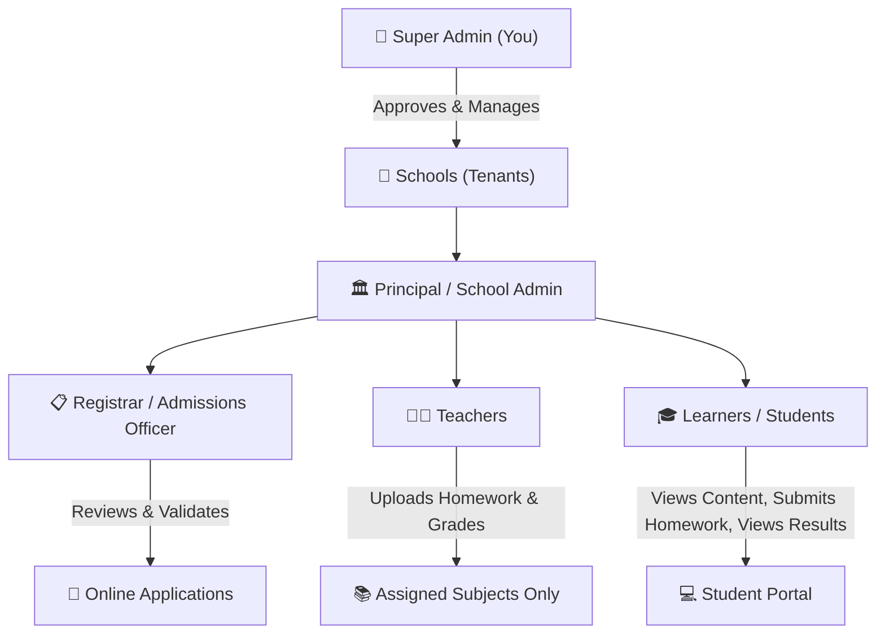
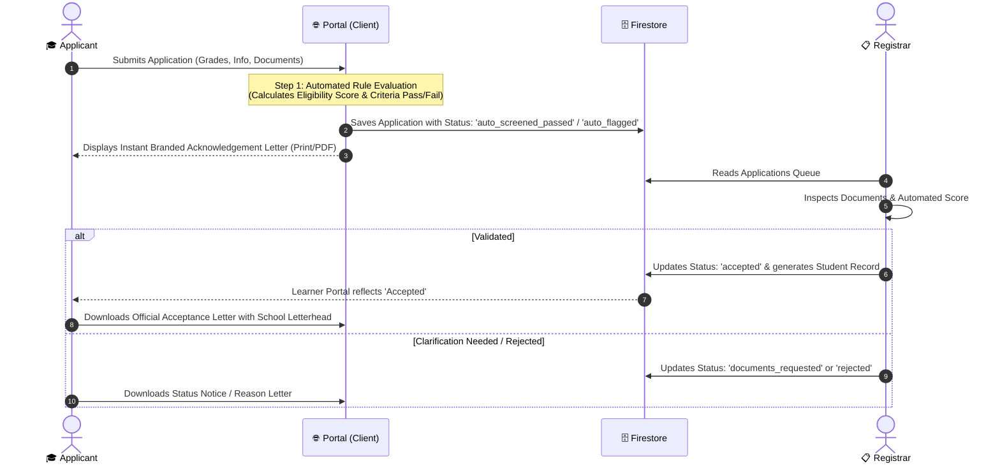

# 🏫 Multi-Tenant School Management System (SaaS)
## Architecture, Lowest-Cost Firebase Strategy & System Plan

---

### 1. Executive Summary & Goals

This system is a **multi-tenant School Management System (SMS)** engineered to serve multiple schools under a central Super-Admin console. It handles the complete lifecycle:
1. **School Onboarding & Setup:** Super-Admin registers and activates schools; School Admins configure branding, letterhead, grades, and subjects.
2. **Automated & Manual Admissions:** Online learner application $\rightarrow$ Instant App Evaluation (Automated Rules Engine) $\rightarrow$ Registrar Verification $\rightarrow$ Acceptance & Enrolment.
3. **Official School Letterhead Engine:** Dynamic, official letter generation (with crest, signature, stamp, date, ref number) at every application step without storage fees.
4. **Academic Portal:** Subjects, teacher content/homework upload, student homework viewer.
5. **Assessment & Report Card Engine:** Subject marks entry, automated term aggregation, and official downloadable term reports.
6. **Zero-Waste / Lowest-Cost Firebase Architecture:** Specifically engineered to stay well within Firebase's free tier (Spark/Blaze free limits) and minimize billable reads, writes, compute, and storage.

---

### 2. Lowest-Cost Firebase Engineering Blueprint

Firebase is extraordinarily fast and scalable, but unoptimized designs (e.g., storing generated PDFs in Storage, unindexed queries, chatty reads, cross-document security rules) lead to unnecessary bills. Here is how we guarantee the **lowest possible operating cost**:

| Component | Common Expensive Anti-Pattern | **Our Ultra-Low Cost Design** | Cost Impact |
| :--- | :--- | :--- | :--- |
| **Document Storage (Letterheads, Letters & Reports)** | Generating PDFs on Cloud Functions and saving binary `.pdf` files to Cloud Storage ($0.026/GB + transfer). | **Client-Side Generation (HTML5 Print & `jspdf`/CSS Print):** Store only lightweight JSON data in Firestore (~1KB). Render pixel-perfect letterheads and report cards directly in the browser. | **$0 Storage & $0 Bandwidth** |
| **Firestore Reads** | Fetching individual records repeatedly on every page navigation. | **Enable `persistentLocalCache` (IndexedDB):** Cache all static/semi-static data (subjects, school profile, terms) locally in browser. Zero reads on repeat views. | **Reduces billable reads by 70–85%** |
| **Data Aggregation (Report Cards)** | Querying 50+ individual assignment/test docs per student to calculate term averages. | **Denormalized Term Summary Docs:** Subject teachers write to student's `termGrades/{termId}`, storing a summary object. Reading a report card requires exactly **1 Firestore Read**. | **98% read reduction per report** |
| **Authentication & RBAC** | Storing roles in Firestore and calling `get(/databases/.../users/$(request.auth.uid))` in Security Rules (which costs 1 billable read per rule evaluation). | **Firebase Auth Custom Claims / User Token context:** Embed `schoolId` and `role` directly in the Auth JWT token or structured user doc. Security rules check `request.auth.token.role` with **0 Firestore Reads**. | **$0 rule evaluation overhead** |
| **File Uploads (Student Certificates/ID)** | Unrestricted file uploads filling Cloud Storage buckets. | **Client-side WebP/Canvas Compression:** Images & photos compressed to $<150$KB before upload. Strict bucket lifecycle rules. | Keeps storage well inside the **5 GB free limit** |
| **Application Evaluation** | Running heavy Cloud Functions on every applicant submit ($0.40/million + CPU time). | **Client-Side Pre-Evaluation + Strict Security Rules Validation:** Form evaluates applicant rules instantly in-browser; Firestore security rules enforce eligibility constraints on document write. | **$0 Cloud Function compute costs** |

---

### 3. Multi-Tenant Role-Based Access Control (RBAC)



#### Granular Privileges Matrix

| Capability | Super Admin | School Admin | Registrar | Teacher | Learner |
| :--- | :---: | :---: | :---: | :---: | :---: |
| Create / Suspend Schools | ✅ | ❌ | ❌ | ❌ | ❌ |
| Configure School Letterhead & Logo | ✅ | ✅ | ❌ | ❌ | ❌ |
| Manage Terms, Subjects & Classes | ❌ | ✅ | ❌ | ❌ | ❌ |
| Assign Teachers to Subjects | ❌ | ✅ | ❌ | ❌ | ❌ |
| Configure Application Rules & Cutoffs | ❌ | ✅ | ✅ | ❌ | ❌ |
| Review & Validate Learner Applications | ❌ | ✅ | ✅ | ❌ | ❌ |
| Issue Acceptance / Status Letters | ❌ | ✅ | ✅ | ❌ | ❌ |
| Enrol Accepted Learners into Classes | ❌ | ✅ | ✅ | ❌ | ❌ |
| Upload Content & Homework | ❌ | ❌ | ❌ | ✅ *(Assigned only)* | ❌ |
| Enter Subject Marks / Assessments | ❌ | ❌ | ❌ | ✅ *(Assigned only)* | ❌ |
| Finalize & Publish Term Reports | ❌ | ✅ | ❌ | ❌ | ❌ |
| View Subject Content & Homework | ❌ | ❌ | ❌ | ✅ | ✅ *(Enrolled only)* |
| View & Download Report Cards / Letters | ❌ | ❌ | ❌ | ❌ | ✅ *(Own only)* |

---

### 4. End-to-End Admissions & Letterhead Workflow



#### The Dynamic School Letterhead Engine
Every school configures their official letterhead once in their School Settings:
- **School Crest / Logo** (URL or compressed image)
- **School Name, Registration / EMIS Number, Motto**
- **Physical Address, Telephone, Email, Website**
- **Digital Stamp & Authorized Signature** (Principal or Registrar)

Whenever an applicant reaches a milestone (Application Received, Conditional Passed, Accepted, Enrolled):
- The client injects the applicant's name, reference number, date, and decision text into the school's letterhead template.
- Can be printed or saved as an authentic PDF with zero server costs using client-side rendering (`window.print` with high-fidelity print CSS or `jspdf`).

---

### 5. Data Model Design (Firestore)

To isolate tenants and enforce strict security rules with zero extra reads:

```
/schools/{schoolId}
  ├── profile: { name, code, address, email, phone, logoUrl, stampUrl, signatureUrl, termsAndConditions }
  ├── admissionSettings: { minAge, maxAge, passScoreThreshold, openGrades: [...], requiredDocs: [...] }
  │
  ├── /academicYears/{yearId}
  │     └── terms: [{ termId, name, startDate, endDate, isCurrent }]
  │
  ├── /classes/{classId}
  │     └── { name: "Grade 10A", gradeLevel: 10, classTeacherId }
  │
  ├── /subjects/{subjectId}
  │     └── { name: "Mathematics", code: "MTH10", gradeLevel: 10, teacherIds: [...] }
  │
  ├── /courseContent/{contentId}
  │     └── { subjectId, title, description, attachments: [...], uploadedBy, createdAt }
  │
  ├── /homework/{homeworkId}
  │     └── { subjectId, classId, title, instructions, dueDate, teacherId, maxMarks }
  │
  ├── /applications/{applicationId}
  │     └── { applicantName, email, phone, gradeApplied, prevMarks, autoEvalResult: { passed, score, notes }, status: "pending" | "auto_passed" | "accepted" | "rejected", documents: [...] }
  │
  ├── /students/{studentId}
  │     └── { uid, admissionNo, fullName, classId, enrolledSubjects: [...], status: "active" }
  │
  └── /reportCards/{reportId} (Document ID: studentId_yearId_termId)
        └── { studentId, termId, yearId, subjects: [{ subjectName, mark, maxMark, grade, teacherRemark }], totalScore, average, principalRemark, status: "draft" | "published" }
```

---

### 6. Implementation Roadmap

1. **Phase 1: Project Setup & Firebase Architecture Foundations**
   - Configure Firebase Client SDK with offline cache enabled (`initializeFirestore(app, { localCache: persistentLocalCache() })`).
   - Setup TailwindCSS styling with a responsive, modern dashboard layout.
   - Configure State Management & Firebase Auth Context with custom claims / tenant context.

2. **Phase 2: Super-Admin & School Onboarding (Multi-Tenancy)**
   - Super Admin dashboard to view all registered schools, activate/suspend schools.
   - School registration flow & Principal account creation.
   - School Admin dashboard to customize school details, branding, logo, stamp, and letterhead layout.

3. **Phase 3: Public Application Portal & Automated Evaluation Engine**
   - Public multi-step application form with school selector or tenant domain/subpath.
   - Client-side document uploader with automatic WebP image compression.
   - Automated evaluation rules engine: validates age, calculates entrance percentage, checks required documents.
   - Dynamic Branded Letterhead generator for Application Acknowledgement.

4. **Phase 4: Registrar Admissions Dashboard & Letter Generation**
   - Admissions review queue (filterable by auto-passed, pending, flagged).
   - Registrar verification modal: document preview, approval/rejection notes.
   - One-click issuance of official School Letterhead Acceptance / Rejection Letters.
   - One-click student account creation and class placement.

5. **Phase 5: Academic Modules & Teacher Portal**
   - Subject & Class management (School Admin assigns teachers to specific subjects).
   - Teacher Dashboard restricted *strictly* to their assigned subjects.
   - Subject Content & Homework creation and distribution.

6. **Phase 6: Marks, Assessments & Term Reports**
   - Teacher marks entry grid for their assigned subjects.
   - Automated aggregation into single term report documents.
   - Principal review & publishing.
   - Learner Portal: view homework, learning materials, results, and print/download official term reports with letterhead.

7. **Phase 7: Security Rules & Cost Verification**
   - Production-ready `firestore.rules` and `storage.rules` ensuring cross-tenant isolation and role enforcement.
   - Free-tier cost verification test.
